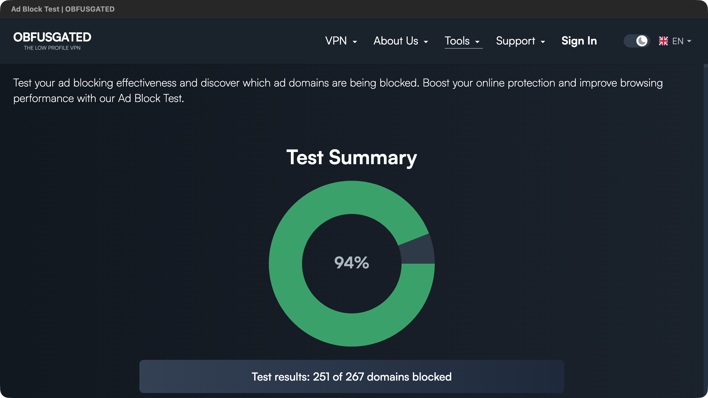

# Adblock-Electron

An Electron adblocking package built on AdGuard's `tsurlfilter` engine.

- **No IPC.**
- **No Preload.** 
- **No Hogging Electron Event Handlers.** 
- **Full Cross-Origin and Same-Origin Cosmetic Filtering.**
- **Consumer Controlled Filters Mirror**

<br>

Adblock-Electron lets you decide how it integrates with your application.
<br> 
Network request blocking without claiming ownership of `onBeforeRequest(()=>{})` or `setWindowOpenHandler(()=>{})`. 
<br> 
Cosmetic filtering and script injection to sub_frames and main_frame with no cross-origin restrictions.
<br>

The supplied [adtidy-filter-mirror](https://github.com/gingergeek8192/adtidy-filter-mirror) repository is intended to be cloned by consumer developers who want to maintain their own filter resources rather than depend on the original repository.

Adblock-Electron updates every 12 hours by fetching from the fastest-responding of the adtidy-filter-mirror. <br> 
The [adtidy-filter-mirror](https://github.com/gingergeek8192/adtidy-filter-mirror) is maintained for Adblock-Electron's first-run and update redundancy, utilizing four hosts (AdTidy, GitHub, jsDelivr, GitLab) across three independent CDN networks `Qrator`, `Fastly` and `Cloudflare`.<br>

Additional third-party filter list support is planned.<br> Results shown below using Adblock-Electron default configuration

## Test Results  🖥️

<table>
<tr>
<td align="center">Ad Blocker Test</td>
<td align="center">Blockify</td>
<td align="center">Obfuscated</td>
<td align="center">Super Adblock Test</td>
</tr>
<tr>
<td align="center"><a href="https://raw.githubusercontent.com/gingergeek8192/Adblock-Electron/main/docs/Ad-Blocker-Test.png"></a></td>
<td align="center"><a href="https://raw.githubusercontent.com/gingergeek8192/Adblock-Electron/main/docs/Blockify.png"></a></td>
<td align="center"><a href="https://raw.githubusercontent.com/gingergeek8192/Adblock-Electron/main/docs/OBFUSCATED.png"></a></td>
<td align="center"><a href="https://raw.githubusercontent.com/gingergeek8192/Adblock-Electron/main/docs/SUPER-ADBLOCK-TEST.png"></a></td>
</tr>
<tr>
<td align="center">100% - 130/130</td>
<td align="center">97% - 58/60</td>
<td align="center">94% - 251/267</td>
<td align="center">90% - 440/482</td>
</tr>
</table>


---

<br> <br>

**Adblock Test Logs 📋 🔥**

Adblock-Electron `withConsole` logs instance initialization events, lifecycle and per-frame cosmetic CSS/JS filter injection. 

<details>
<summary>View Logs </summary>

```js
────────────────────────────────────────────────────────────────────────
  HANDLER INITIALIZATION
────────────────────────────────────────────────────────────────────────
{
  setWindowOpenHandler: { registered: true, withWindowOpenHandler: true, owner: 'consumer' },
  onBeforeRequest: { registered: true, withBeforeRequest: true, owner: 'consumer' }
}
────────────────────────────────────────────────────────────────────────
────────────────────────────────────────────────────────────────────────
  MAIN_FRAME CAPABILITY
────────────────────────────────────────────────────────────────────────
{
  sessionId: 'main',
  Capability: 'fullSet',
  Protocols: [
    { Protocol: 'Network', Enabled: true },
    { Protocol: 'Debugger', Enabled: true },
    { Protocol: 'DOM', Enabled: true },
    { Protocol: 'Runtime', Enabled: true },
    { Protocol: 'Target', Enabled: true },
    { Protocol: 'Page', Enabled: true }
  ],
  AutoAttach: true,
  Active: [ 'main' ],
  Inactive: []
}
────────────────────────────────────────────────────────────────────────
────────────────────────────────────────────────────────────────────────
  COSMETIC INJECTION
────────────────────────────────────────────────────────────────────────
{
  type: 'CSS',
  frameId: '346911B95404753EB33539501326C57D',
  sessionId: 'main',
  frame: 'main_frame',
  injected: true
}
────────────────────────────────────────────────────────────────────────
────────────────────────────────────────────────────────────────────────
  COSMETIC INJECTION
────────────────────────────────────────────────────────────────────────
{
  type: 'SCRIPT',
  frameId: '346911B95404753EB33539501326C57D',
  sessionId: 'main',
  frame: 'main_frame',
  injected: true
}
────────────────────────────────────────────────────────────────────────
────────────────────────────────────────────────────────────────────────
  SUB_FRAME CAPABILITY
────────────────────────────────────────────────────────────────────────
{
  sessionId: 'D13136189FFB8591666C43A02A8562C3',
  Capability: 'fullSet',
  Protocols: [
    { Protocol: 'Network', Enabled: true },
    { Protocol: 'Debugger', Enabled: true },
    { Protocol: 'DOM', Enabled: true },
    { Protocol: 'Runtime', Enabled: true },
    { Protocol: 'Target', Enabled: true }
  ],
  AutoAttach: true,
  Active: [ 'main', 'D13136189FFB8591666C43A02A8562C3' ],
  Inactive: []
}
────────────────────────────────────────────────────────────────────────
────────────────────────────────────────────────────────────────────────
  COSMETIC INJECTION
────────────────────────────────────────────────────────────────────────
{
  type: 'CSS',
  frameId: 'CC939D2141ED95A8BAD9B43233504826',
  sessionId: 'D13136189FFB8591666C43A02A8562C3',
  frame: 'sub_frame',
  injected: true
}
────────────────────────────────────────────────────────────────────────
────────────────────────────────────────────────────────────────────────
  COSMETIC INJECTION
────────────────────────────────────────────────────────────────────────
{
  type: 'SCRIPT',
  frameId: 'CC939D2141ED95A8BAD9B43233504826',
  sessionId: 'D13136189FFB8591666C43A02A8562C3',
  frame: 'sub_frame',
  injected: true
}
────────────────────────────────────────────────────────────────────────
```

</details>

<br>

## ⚡ API Introduction

To filter network requests without taking ownership of key Electron event handlers, Adblock-Electron binds handlers to the class instance. 

<br> 

Event handlers are then exposed to the consumer application **on** the Adblock Object ...

- `Adblock.setWindowOpenHandler({})`

...or as a **callback** via a **listener registered** on the Adblock Object ...

- `Adblock.onBeforeReady(blocker => blocker.onBeforeRequest(()=>{}))`

The availability of event handlers depends on the configuration specified during `createAdblock({...})` instantiation and the lifecycle of the class instance.

<br>

Adblock-Electron's initialization API is therefore primarily event-driven. 

<br>


❗ **Event-driven:** 
<br> 
`setResources({})` → `createReady(()=>{})` → `createAdblock({})` → <br> `onBeforeReady(()=>{})` → `setWindowOpenHandler(()=>{})` → `urlReady(()=>{})`

<br>

The Adblock `tsurlfilter` engine must be initialized before Adblock instantiation.
<br>

## Initialize `tsurlfilter` Adblock-Engine `setResources({})`

### ⚙️ Options

- Specific filter group IDs `withGroups` (default all groupIds), 
- Language: `withLanguageSpecific` (default English)
- Build mode: synchronous / asynchronous `withBuildSync` (default Async)
- Consumer-controlled filter mirror `withOwnMirror`  Accepts an account (user-name) and optIns array specifying enabled providers [`GITHUB`, `GITLAB`, `JSDELIVR`]
<br>


<details> 
<summary>Supported language codes</summary> 

Codes come from the `languages` field of AdTidy's `filters.json` (non-deprecated filters, Nov 2026) and may change.

| Code | Language | Code | Language |
|---|---|---|---|
| `ar` | Arabic | `ko` | Korean |
| `bg` | Bulgarian | `lt` | Lithuanian |
| `cs` | Czech | `lv` | Latvian |
| `da` | Danish | `mk` | Macedonian |
| `de` | German | `nl` | Dutch |
| `es` | Spanish | `no` | Norwegian |
| `et` | Estonian | `pl` | Polish |
| `fa` | Persian | `ps` | Pashto |
| `fi` | Finnish | `pt` | Portuguese |
| `fo` | Faroese | `ru` | Russian |
| `fr` | French | `sk` | Slovak |
| `he` | Hebrew | `sr` | Serbian |
| `hi` | Hindi | `sv` | Swedish |
| `hr` | Croatian | `tg` | Tajik |
| `hu` | Hungarian | `th` | Thai |
| `id` | Indonesian | `tr` | Turkish |
| `is` | Icelandic | `uk` | Ukrainian |
| `it` | Italian | `vi` | Vietnamese |
| `ja` | Japanese | `zh` | Chinese |

</details>

<details>
<summary>Supported filter groups</summary>

Group names are case-insensitive. An invalid name throws an error listing the supported values.

| Group | Description |
|---|---|
| `AdBlocking` | Blocks ads |
| `Privacy` | Blocks trackers |
| `SocialWidgets` | Blocks social media elements, such as Like and Share buttons |
| `Annoyances` | Blocks cookie notices, in-page popups and similar |
| `Security` | Blocks phishing and malicious websites |
| `Other` | Miscellaneous filters that fit no other group |
| `Language` | Language-specific filters, selected by `withLanguageSpecific` |

</details>
<br>

Calling `setResources()` without arguments defaults `withGroups` to all filter groups and `withLanguageSpecific` to English.
```js

Adblock.setResources() // without args builds with defaults as below

Adblock.setResources({
    withBuildSync: false, // default async
    withLanguageSpecific: "en", // default English
    withGroups: [
        "AdBlocking",
        "Privacy",
        "SocialWidgets",
        "Annoyances",
        "Security",
        "Other",
        "Language"
    ], // default all filter list groupIds included
    withOwnMirror: { 
      account: 'your-username',
      optIns: [
          `JSDELIVR`,
          `GITLAB`,   
          `GITHUB`  
                     // Adtidy is included by default
      ]
  }
})

```
Calling `setResources({})` at the earliest opportunity is advised
```js

// electron event
// app.whenReady().then(() => {

  Adblock.setResources()

// })

```
On first run, initialization is non-blocking regardless of the `withBuildSync` setting. <br>
Adblock-Electron downloads and builds the engine asynchronously. The `createReady` event fires before filter lists are cached asynchronously. <br>
On subsequent runs `withBuildSync: true` will build the engine synchronously before the consumer window appears.

```js

Adblock.setResources({
    withBuildSync: true,
    withGroups: [
        "AdBlocking",  // group names are case-insensitive
        "Annoyances",  // ✓ valid
        // "Annoyance" // ✗ invalid: throws and lists the supported group names
        "Security",
        "Language"
    ]
})

```

With `withBuildSync: false` (default), the engine builds asynchronously and `createReady(()=>{})` is emitted when it is ready. 
<br>
## ⚡ Creating Adblock Instance `createAdblock({...})`

- 🚨 Note: 
  <br>
  Adblock `Object` refers to the global Object exposing the Adblock-Electron API
  <br>
  Adblock `instance` refers to the ad blocking / filtering `class` instance


 

### ⚙️ Options

- Mandatory `webContents` instance (looked up via `webContents.id`)
- Setting `withBeforeRequest: true` registers `onBeforeReady(()=>{})` on the Adblock Object
- Setting `withWindowOpenHandler: true` registers `setWindowOpenHandler(()=>{})` on the Adblock Object

<br>

<details>
<summary>createAdblock options 📋 💬 </summary>

| Name | Type | Default | Description |
|---|---|---|---|
| `webContents` | `Electron.WebContents` | - | Target to attach to |
| `withBeforeRequest` | `boolean` | `false` | `true`: consumer owns `onBeforeRequest(()=>{})` via `onBeforeReady(()=>{})` |
| `withWindowOpenHandler` | `boolean` | `false` | `true`: consumer decides window opens via `setWindowOpenHandler(()=>{})` |
| `withAllowIncludesArray` | `string[]` | `[]` | URL substrings allowed. Takes priority over `withBlockIncludesArray`. |
| `withBlockIncludesArray` | `string[]` | `['devtools', 'devtool']` | URL substrings blocked. |
| `withAutoAttachFilter` | `Object[]` | `workers` | Attachment types excluded from interception. Defaults to `service_worker`, `shared_worker`, and `worker`. |
| `withDebuggerResume` | `boolean` | `true` | Auto-resume debugger-paused targets. Enabled by default. |
| `withConsole` | `boolean` | `false` | Diagnostic console output. |

<br>

<h2>Evolution of createAdblock options</h2>

Adblock-Electron originated from a practical requirement: removing advertising, trackers, and intrusive pop-ups from streaming sites while providing the ability to inspect their source.<br>
Many streaming sites employ techniques intended to interfere with developer tools, including debugger traps, execution pauses, console manipulation, and scripts designed to detect DevTools activity.<br>
Adblock-Electron incorporates mechanisms to counteract this interference, including automatic debugger resumption, protection against console clearing, and targeted blocking of DevTools-related scripts and requests.<br>
These requirements directly influenced several of the available configuration options, particularly `withBlockIncludesArray` and `withDebuggerResume`. The related `withAutoAttachFilter` option was also shaped by these requirements to ensure the package targets the correct frame types.<br>
What began as a solution to a specific problem evolved into an independent adblocking implementation for Electron, with network filtering, cross-origin cosmetic filtering, and script injection.

</details>

<br>

Instantiating Adblock with `createAdblock({...})` on the `createReady(()=>{})` event:

## Minimal configuration

Supply the mandatory webContents argument and let Adblock-Electron apply its defaults.

```js

// Default config passing the mandatory webContents argument only ...
Adblock.createReady(() => 
    Adblock.createAdblock({
        webContents: win.webContents
    })
)

```

### The equivalent configuration with all defaults declared explicitly:

```js

Adblock.createReady(() =>
    Adblock.createAdblock({
        webContents: win.webContents,
        withAllowIncludesArray: [],
        withBlockIncludesArray: ["devtools", "devtool"], // Blocks 
        withBeforeRequest: false,
        withWindowOpenHandler: false,
        withDebuggerResume: true, // Counteracts sites deliberately pausing execution when they detect DevTools (e.g. streaming sites).
        withAutoAttachFilter: [ // Stops Adblock-Electron targeting workers.
            { type: "service_worker", exclude: true },
            { type: "shared_worker", exclude: true },
            { type: "worker", exclude: true },
        ],

        withConsole: false
    })
)

```

<br>

The Adblock class can be instantiated once the `createReady(()=>{})` event has fired.<br> 
If `createReady(()=>{})` has not been registered, `isReady()` can be called. It returns `true` if the engine is ready, or `false` if the event is pending.

```js

if (Adblock.isReady()) {
    // Engine ready
    // createAdblock({...})
} else {
    Adblock.createReady(() => {
        // Listener for engine ready state event
        // createAdblock({...})
    })
}

``` 
<br>

## `onBeforeRequest(()=>{})`


Instantiating the Adblock class setting `withBeforeRequest: true` binds Electron's `onBeforeRequest(()=>{})` listener to the Adblock class instance and the `onBeforeReady(()=>{})` event listener is made available to the consumer on the Adblock Object.
The registered event listener fires and passes `onBeforeRequest(()=>{})` to the consumer as a callback.

❗ Adblock's `onBeforeReady(()=>{})` can only be registered after `createReady(()=>{})` has fired and `createAdblock({ withBeforeRequest: true })` is called.

```js

Adblock.onBeforeReady(
  win.webContents, 

  (blocker) => {
    blocker.onBeforeRequest({ urls: ['http://*/*', 'https://*/*'] },
        ({ url, resourceType }, cb) => {

            // app-specific priority logic 
            // if (myPriorityCheck(url)) { return cb({...}) }

            if (blocker.match(url, resourceType)) 
                return cb({ cancel: true })

            // app-specific logic on filtered requests
            // if (mySecondaryCheck(url)) { return cb({...}) }

            return cb({})
        }
    )

})

```
<br>

## `setWindowOpenHandler(()=>{})`

Adblock-Electron dynamically exposes its `setWindowOpenHandler(()=>{})` method on the Adblock global object. This provides consumer-managed access to Electron's window-opening handler.

❗ `setWindowOpenHandler(()=>{})` is only available when the Adblock class is instantiated with `withWindowOpenHandler: true`.

The callback receives an `openWindow(boolean)` method for setting the window-opening decision:

<br>

- `openWindow(true)` — allows window creation (`{ action: "allow" }`)
- `openWindow(false)` — denies window creation (`{ action: "deny" }`)

<br>

The consumer has full control over the window-opening decision and can use `blocker.match(url)`, direct string comparisons, referrer validation, or any combination of custom conditions.
The consumer can therefore implement their own window-opening policies without relying on Adblock's URL matching.

<br>

---

Using Adblock's matching engine

```js

Adblock.setWindowOpenHandler(
  win.webContents,

    (blocker, { url }) => {
        blocker.openWindow(
          !blocker.match(url) // match() returns true when the URL is blocked
        ) 
    }

)

```

<br>

---

Using custom conditions

```js

Adblock.setWindowOpenHandler(
    win.webContents,

    (blocker, { url, referrer }) => {

        blocker.openWindow(
            url === myURL &&
            referrer === mySafeReferrer
        )

    }
)

```
---

<br>

## `urlReady(()=>{})` 🚀

The last event to fire is `urlReady(()=>{})`; at this point, we're about to block some ads 🚫

```js

  Adblock.urlReady(win.webContents, () => 

    win.webContents.loadURL(url)
      .then(() => win.webContents.openDevTools())
      .catch(() => {});

  );

```

<br>

## `onActionableResourceEvent(()=>{})` 

<br> 

Adblock-Electron uses multiple resource hosts with automatic fallback and recovery.
<br> 
Individual endpoint failures are handled internally wherever possible.
<br>

Adblock-Electron's `onActionableResourceEvent()` exposes conditions requiring host-application awareness, including ***resource availability***, ***filesystem access***, ***persistence failures*** and ***online connectivity***.
<br>
Events include an error code and operational percentage, allowing the host application to determine whether intervention is necessary without making resource failures fatal to the application.
