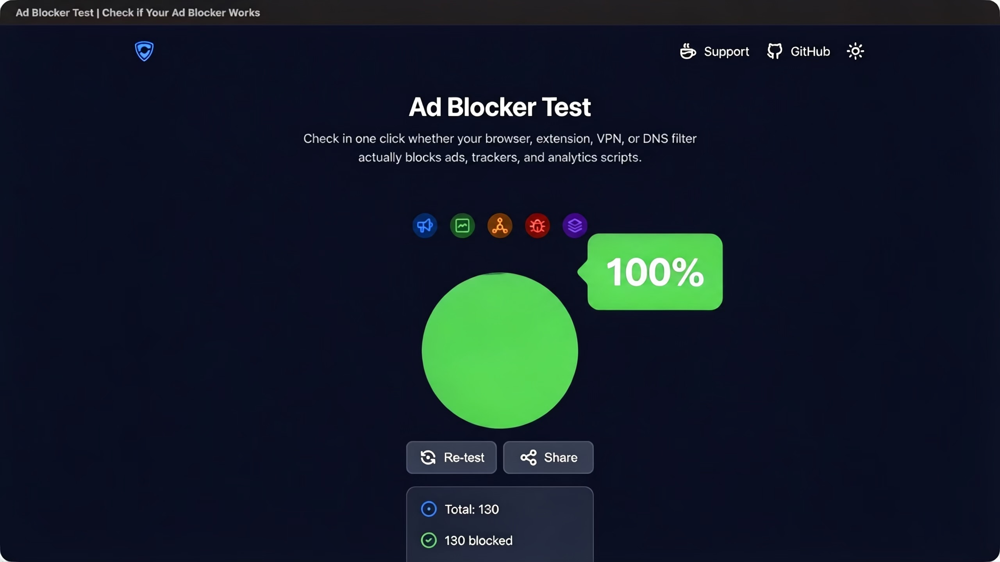

# Adblock-Electron

An Electron adblocking package built on AdGuard's `tsurlfilter` engine.

**No preload scripts required. No forced ownership of your application's event handlers. No IPC channel. Full cross-origin and same-origin cosmetic filtering.**

Adblock-Electron combines network-level ad blocking with cosmetic filtering and script injection, giving Electron applications comprehensive adblocking without requiring changes to their renderer architecture.

Unlike solutions that impose event-handler ownership, Adblock-Electron lets you decide how it integrates with your application. 
Keep control of your existing onBeforeRequest and setWindowOpenHandler, or let Adblock manage them internally. Either way network level blocking is fully supported
with the addition of custom allow or block requests arrays.

No IPC channel is required for inter process cosmetic injections and no preload is required for those apps using nodeIntegration or contextIsolation false.

Cosmetic filtering works across attached sub_frame and main_frame with no reliance on ordinary page-script access or same-origin restrictions.

Built on AdGuard's powerful `tsurlfilter` engine, selected for this package after out-performing competing engines in real world blocking comparison score.
Adblock-Electron updates filters every 12 hours fetching from fastest-responder of 4 [adtidy-filter-mirror](https://github.com/gingergeek8192/adtidy-filter-mirror) hosts, maintained for redundant filter delivery through independent infrastructures.


## Test Results
- screenshots

<details>
<summary>View Screenshots</summary>

<p>
<a href="https://raw.githubusercontent.com/gingergeek8192/Adblock-Electron/main/docs/Ad-Blocker-Test.png"></a>
<a href="https://raw.githubusercontent.com/gingergeek8192/Adblock-Electron/main/docs/Blockify.png"></a>
<a href="https://raw.githubusercontent.com/gingergeek8192/Adblock-Electron/main/docs/OBFUSCATED.png"></a>
<a href="https://raw.githubusercontent.com/gingergeek8192/Adblock-Electron/main/docs/Can-You-Block-It.png"></a>
<a href="https://raw.githubusercontent.com/gingergeek8192/Adblock-Electron/main/docs/SUPER-ADBLOCK-TEST.png"></a>
</p>

</details>

- Test Logs

<details>
<summary>View Logs</summary>

```js
Adblock Ready
adblock-create-ready
────────────────────────────────────────────────────────────────────────
  HANDLER INITIALIZATION
────────────────────────────────────────────────────────────────────────
{
  setWindowOpenHandler: { registered: true, withWindowOpenHandler: true, owner: 'consumer' },
  onBeforeRequest: { registered: true, withBeforeRequest: true, owner: 'consumer' }
}
────────────────────────────────────────────────────────────────────────
────────────────────────────────────────────────────────────────────────
  CDP SESSION MAIN_FRAME CAPABILITY
────────────────────────────────────────────────────────────────────────
{
  sessionId: 'main',
  Capability: 'fullSet',
  Protocols: [
    { Protocol: 'Network', Enabled: true },
    { Protocol: 'Debugger', Enabled: true },
    { Protocol: 'DOM', Enabled: true },
    { Protocol: 'Runtime', Enabled: true },
    { Protocol: 'Target', Enabled: true },
    { Protocol: 'Page', Enabled: true }
  ],
  AutoAttach: true,
  Active: [ 'main' ],
  Inactive: []
}
────────────────────────────────────────────────────────────────────────
────────────────────────────────────────────────────────────────────────
  COSMETIC INJECTION
────────────────────────────────────────────────────────────────────────
{
  type: 'CSS',
  frameId: '346911B95404753EB33539501326C57D',
  sessionId: 'main',
  frame: 'main_frame',
  injected: true
}
────────────────────────────────────────────────────────────────────────
────────────────────────────────────────────────────────────────────────
  COSMETIC INJECTION
────────────────────────────────────────────────────────────────────────
{
  type: 'SCRIPT',
  frameId: '346911B95404753EB33539501326C57D',
  sessionId: 'main',
  frame: 'main_frame',
  injected: true
}
────────────────────────────────────────────────────────────────────────
────────────────────────────────────────────────────────────────────────
  CDP SESSION SUB_FRAME CAPABILITY
────────────────────────────────────────────────────────────────────────
{
  sessionId: 'D13136189FFB8591666C43A02A8562C3',
  Capability: 'fullSet',
  Protocols: [
    { Protocol: 'Network', Enabled: true },
    { Protocol: 'Debugger', Enabled: true },
    { Protocol: 'DOM', Enabled: true },
    { Protocol: 'Runtime', Enabled: true },
    { Protocol: 'Target', Enabled: true }
  ],
  AutoAttach: true,
  Active: [ 'main', 'D13136189FFB8591666C43A02A8562C3' ],
  Inactive: []
}
────────────────────────────────────────────────────────────────────────
────────────────────────────────────────────────────────────────────────
  COSMETIC INJECTION
────────────────────────────────────────────────────────────────────────
{
  type: 'CSS',
  frameId: 'CC939D2141ED95A8BAD9B43233504826',
  sessionId: 'D13136189FFB8591666C43A02A8562C3',
  frame: 'sub_frame',
  injected: true
}
────────────────────────────────────────────────────────────────────────
────────────────────────────────────────────────────────────────────────
  COSMETIC INJECTION
────────────────────────────────────────────────────────────────────────
{
  type: 'SCRIPT',
  frameId: 'CC939D2141ED95A8BAD9B43233504826',
  sessionId: 'D13136189FFB8591666C43A02A8562C3',
  frame: 'sub_frame',
  injected: true
}
────────────────────────────────────────────────────────────────────────
```

</details>