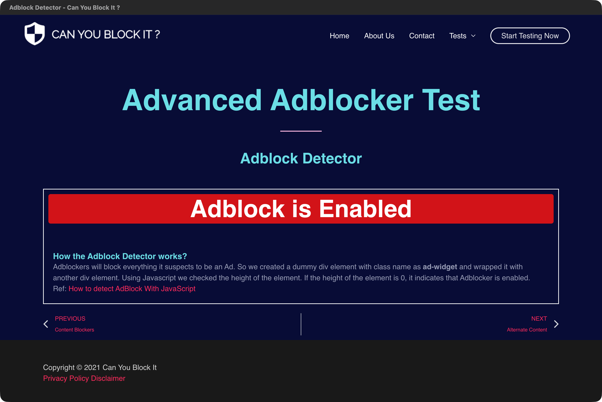
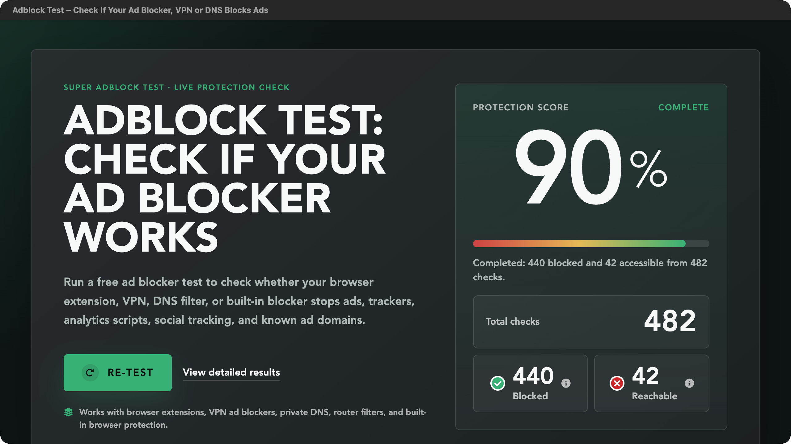

# Adblock-Electron

An Electron adblocking package built on AdGuard's `tsurlfilter` engine.

- **No Preload Scripts.** 
- **No IPC Costs.**
- **No Forced Ownership of Electron Event Handlers.** 
- **Full Cross-Origin and Same-Origin Cosmetic Filtering.**

<br>

Adblock-Electron lets you decide how it integrates with your app.
<br> 

Providing network request blocking, cosmetic filtering and script injection without taking ownership of `onBeforeRequest` or `setWindowOpenHandler`.<br> 
No unzipped extensions `session.extensions.loadExtension()`.<br> 
Cosmetic filtering in sub_frame and main_frame with no cross-origin restrictions and built around AdGuard's powerful `tsurlfilter` engine. 

Adblock-Electron updates every 12 hours fetching from fastest responder of 4 [adtidy-filter-mirror](https://github.com/gingergeek8192/adtidy-filter-mirror) hosts maintained for redundancy across 3 independent networks. 


## Test Results
- Adblock Test Screenshots

<details>
<summary>View Screenshots 📋</summary> 

<p>
<a href="https://raw.githubusercontent.com/gingergeek8192/Adblock-Electron/main/docs/Ad-Blocker-Test.png"></a>
<a href="https://raw.githubusercontent.com/gingergeek8192/Adblock-Electron/main/docs/Blockify.png"></a>
<a href="https://raw.githubusercontent.com/gingergeek8192/Adblock-Electron/main/docs/OBFUSCATED.png"></a>
<a href="https://raw.githubusercontent.com/gingergeek8192/Adblock-Electron/main/docs/Can-You-Block-It.png"></a>
<a href="https://raw.githubusercontent.com/gingergeek8192/Adblock-Electron/main/docs/SUPER-ADBLOCK-TEST.png"></a>
</p>

</details>

- Adblock Test Logs

<details>
<summary>View Screenshots 📋</summary> 
<summary>View Logs </summary>

```js
Adblock Ready
adblock-create-ready
────────────────────────────────────────────────────────────────────────
  HANDLER INITIALIZATION
────────────────────────────────────────────────────────────────────────
{
  setWindowOpenHandler: { registered: true, withWindowOpenHandler: true, owner: 'consumer' },
  onBeforeRequest: { registered: true, withBeforeRequest: true, owner: 'consumer' }
}
────────────────────────────────────────────────────────────────────────
────────────────────────────────────────────────────────────────────────
  CDP SESSION MAIN_FRAME CAPABILITY
────────────────────────────────────────────────────────────────────────
{
  sessionId: 'main',
  Capability: 'fullSet',
  Protocols: [
    { Protocol: 'Network', Enabled: true },
    { Protocol: 'Debugger', Enabled: true },
    { Protocol: 'DOM', Enabled: true },
    { Protocol: 'Runtime', Enabled: true },
    { Protocol: 'Target', Enabled: true },
    { Protocol: 'Page', Enabled: true }
  ],
  AutoAttach: true,
  Active: [ 'main' ],
  Inactive: []
}
────────────────────────────────────────────────────────────────────────
────────────────────────────────────────────────────────────────────────
  COSMETIC INJECTION
────────────────────────────────────────────────────────────────────────
{
  type: 'CSS',
  frameId: '346911B95404753EB33539501326C57D',
  sessionId: 'main',
  frame: 'main_frame',
  injected: true
}
────────────────────────────────────────────────────────────────────────
────────────────────────────────────────────────────────────────────────
  COSMETIC INJECTION
────────────────────────────────────────────────────────────────────────
{
  type: 'SCRIPT',
  frameId: '346911B95404753EB33539501326C57D',
  sessionId: 'main',
  frame: 'main_frame',
  injected: true
}
────────────────────────────────────────────────────────────────────────
────────────────────────────────────────────────────────────────────────
  CDP SESSION SUB_FRAME CAPABILITY
────────────────────────────────────────────────────────────────────────
{
  sessionId: 'D13136189FFB8591666C43A02A8562C3',
  Capability: 'fullSet',
  Protocols: [
    { Protocol: 'Network', Enabled: true },
    { Protocol: 'Debugger', Enabled: true },
    { Protocol: 'DOM', Enabled: true },
    { Protocol: 'Runtime', Enabled: true },
    { Protocol: 'Target', Enabled: true }
  ],
  AutoAttach: true,
  Active: [ 'main', 'D13136189FFB8591666C43A02A8562C3' ],
  Inactive: []
}
────────────────────────────────────────────────────────────────────────
────────────────────────────────────────────────────────────────────────
  COSMETIC INJECTION
────────────────────────────────────────────────────────────────────────
{
  type: 'CSS',
  frameId: 'CC939D2141ED95A8BAD9B43233504826',
  sessionId: 'D13136189FFB8591666C43A02A8562C3',
  frame: 'sub_frame',
  injected: true
}
────────────────────────────────────────────────────────────────────────
────────────────────────────────────────────────────────────────────────
  COSMETIC INJECTION
────────────────────────────────────────────────────────────────────────
{
  type: 'SCRIPT',
  frameId: 'CC939D2141ED95A8BAD9B43233504826',
  sessionId: 'D13136189FFB8591666C43A02A8562C3',
  frame: 'sub_frame',
  injected: true
}
────────────────────────────────────────────────────────────────────────
```

</details>

<br>

## ⚡ API Introduction

To filter network requests without taking ownership of key Electron event handlers Adblock-Electron binds handlers to the class instance. <br> Event handlers are then exposed to the consumer application **on** the Adblock Object...

- `Adblock.setWindowOpenHandler({})`

...or as a **callback** via a **listener registered** on the Adblock Object...

- `Adblock.onBeforeReady(blocker => blocker.onBeforeRequest({}))`

The availability of event handlers depends on the configuration specified during instantiation and the lifecycle of the class instance.<br>
Adblock-Electron's initialization API is therefore primarily event-driven. <br>
The Adblock `tsUrlFilters` engine must be initialized before Adblock instantiation.

<br>

## Initialize `tsUrlFilters` Adblock-Engine 

### ⚙️ Options

- Specific filter groupIds `withGroups` (default all groupIds), 
- Language `withLanguageSpecific` (default English)
- Mode Sync / Async `withBuildSync` (default Async)

<br>

---

<br>

Calling `setResources()` without arguments enables all filter groups and uses English as the language-specific filter selection.
```js
Adblock.setResources() // without args builds with defaults as below

Adblock.setResources({
    withBuildSync: false, // default async
    withLanguageSpecific: "en", // default english
    withGroups: [
        "AdBlocking",
        "Privacy",
        "SocialWidgets",
        "Annoyances",
        "Security",
        "Other",
        "Language"
    ] // all filter list groupIds included
})
```
Calling `setResources` at earliest opportunity is advised
```js
// electron event
// app.whenReady().then(() => {

  Adblock.setResources()

// })
```
First run is non-blocking regardless of `withBuildSync` setting. </br>
Adblock-electron downloads and builds the engine asynchronously, `createReady` is triggered before filters are asynchronously cached. <br>
On subsequent runs `withBuildSync:true` will build the engine synchronously before the consumer window appears.

```js
Adblock.setResources({
    withBuildSync: true, 
    withGroups: [
        "AdBlocking",
        "Annoyances",
        "Security",
        "Language"
    ]
})
```

The `withBuildSync:false` (default) the engine builds async and `createReady` is emitted when the engine is ready for use. 
<br>
<br>

## ⚡ Creating Adblock Instance


