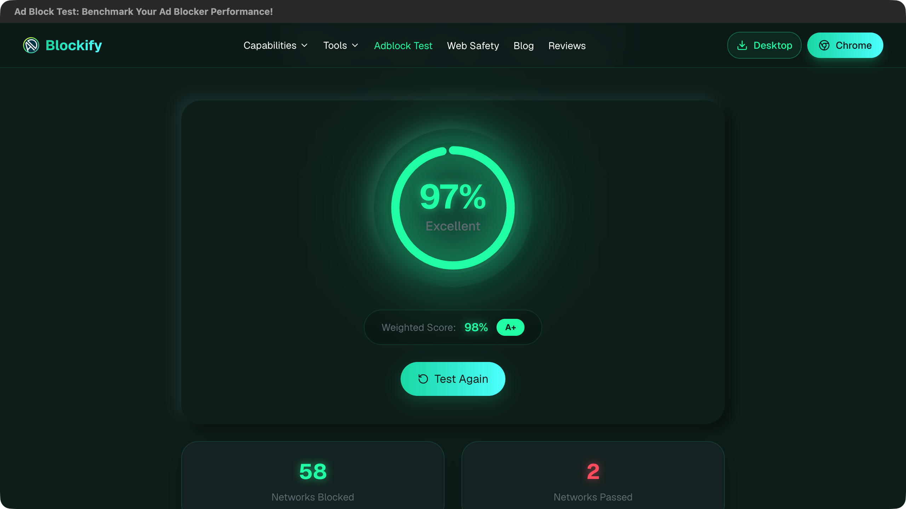

# Adblock-Electron

An Electron adblocking package built on AdGuard's `tsurlfilter` engine.

- **No IPC.**
- **No Preload.** 
- **No Hogging Electron Event Handlers.** 
- **Full Cross-Origin and Same-Origin Cosmetic Filtering.**

<br>

Adblock-Electron lets you decide how it integrates with your application.
<br> 
Network request blocking without claiming ownership of `onBeforeRequest` or `setWindowOpenHandler`. 
<br> Cosmetic filtering and script injection to sub_frames and main_frame with no cross-origin restrictions.<br>
Built on AdGuard's powerful `tsurlfilter` engine. 

Adblock-Electron updates every 12 hours fetching from the fastest responder of the adtidy-filter-mirror. <br> 
The [adtidy-filter-mirror](https://github.com/gingergeek8192/adtidy-filter-mirror) is  maintained for Adblock-Electron first run and update redundancy with 4 hosts (AdTidy, GitHub, jsDelivr, GitLab) across 3 independent CDN networks `Qrator`, `Fastly` and `Cloudflare`.<br>


## Test Results
- Test Site Screenshots 🖥️

<p>
<a href="https://raw.githubusercontent.com/gingergeek8192/Adblock-Electron/main/docs/Ad-Blocker-Test.png"></a>
<a href="https://raw.githubusercontent.com/gingergeek8192/Adblock-Electron/main/docs/Blockify.png"></a>
<a href="https://raw.githubusercontent.com/gingergeek8192/Adblock-Electron/main/docs/OBFUSCATED.png"></a>
<a href="https://raw.githubusercontent.com/gingergeek8192/Adblock-Electron/main/docs/SUPER-ADBLOCK-TEST.png"></a>
</p>


- Adblock Test Logs 📋

<details>
<summary>View Logs </summary>

```js
────────────────────────────────────────────────────────────────────────
  HANDLER INITIALIZATION
────────────────────────────────────────────────────────────────────────
{
  setWindowOpenHandler: { registered: true, withWindowOpenHandler: true, owner: 'consumer' },
  onBeforeRequest: { registered: true, withBeforeRequest: true, owner: 'consumer' }
}
────────────────────────────────────────────────────────────────────────
────────────────────────────────────────────────────────────────────────
  CDP SESSION MAIN_FRAME CAPABILITY
────────────────────────────────────────────────────────────────────────
{
  sessionId: 'main',
  Capability: 'fullSet',
  Protocols: [
    { Protocol: 'Network', Enabled: true },
    { Protocol: 'Debugger', Enabled: true },
    { Protocol: 'DOM', Enabled: true },
    { Protocol: 'Runtime', Enabled: true },
    { Protocol: 'Target', Enabled: true },
    { Protocol: 'Page', Enabled: true }
  ],
  AutoAttach: true,
  Active: [ 'main' ],
  Inactive: []
}
────────────────────────────────────────────────────────────────────────
────────────────────────────────────────────────────────────────────────
  COSMETIC INJECTION
────────────────────────────────────────────────────────────────────────
{
  type: 'CSS',
  frameId: '346911B95404753EB33539501326C57D',
  sessionId: 'main',
  frame: 'main_frame',
  injected: true
}
────────────────────────────────────────────────────────────────────────
────────────────────────────────────────────────────────────────────────
  COSMETIC INJECTION
────────────────────────────────────────────────────────────────────────
{
  type: 'SCRIPT',
  frameId: '346911B95404753EB33539501326C57D',
  sessionId: 'main',
  frame: 'main_frame',
  injected: true
}
────────────────────────────────────────────────────────────────────────
────────────────────────────────────────────────────────────────────────
  CDP SESSION SUB_FRAME CAPABILITY
────────────────────────────────────────────────────────────────────────
{
  sessionId: 'D13136189FFB8591666C43A02A8562C3',
  Capability: 'fullSet',
  Protocols: [
    { Protocol: 'Network', Enabled: true },
    { Protocol: 'Debugger', Enabled: true },
    { Protocol: 'DOM', Enabled: true },
    { Protocol: 'Runtime', Enabled: true },
    { Protocol: 'Target', Enabled: true }
  ],
  AutoAttach: true,
  Active: [ 'main', 'D13136189FFB8591666C43A02A8562C3' ],
  Inactive: []
}
────────────────────────────────────────────────────────────────────────
────────────────────────────────────────────────────────────────────────
  COSMETIC INJECTION
────────────────────────────────────────────────────────────────────────
{
  type: 'CSS',
  frameId: 'CC939D2141ED95A8BAD9B43233504826',
  sessionId: 'D13136189FFB8591666C43A02A8562C3',
  frame: 'sub_frame',
  injected: true
}
────────────────────────────────────────────────────────────────────────
────────────────────────────────────────────────────────────────────────
  COSMETIC INJECTION
────────────────────────────────────────────────────────────────────────
{
  type: 'SCRIPT',
  frameId: 'CC939D2141ED95A8BAD9B43233504826',
  sessionId: 'D13136189FFB8591666C43A02A8562C3',
  frame: 'sub_frame',
  injected: true
}
────────────────────────────────────────────────────────────────────────
```

</details>

<br>

## ⚡ API Introduction

To filter network requests without taking ownership of key Electron event handlers Adblock-Electron binds handlers to the class instance. <br> Event handlers are then exposed to the consumer application **on** the Adblock Object...

- `Adblock.setWindowOpenHandler({})`

...or as a **callback** via a **listener registered** on the Adblock Object...

- `Adblock.onBeforeReady(blocker => blocker.onBeforeRequest({}))`

The availability of event handlers depends on the configuration specified during instantiation and the lifecycle of the class instance.<br>
Adblock-Electron's initialization API is therefore primarily event-driven. <br>
The Adblock `tsurlfilter` engine must be initialized before Adblock instantiation.

<br>

## Initialize `tsurlfilter` Adblock-Engine 

### ⚙️ Options

- Specific filter groupIds `withGroups` (default all groupIds), 
- Language `withLanguageSpecific` (default English)
- Mode Sync / Async `withBuildSync` (default Async)

<br>

<details> 
<summary>Supported language codes</summary> 

Codes come from the `languages` field of AdTidy's `filters.json` (non-deprecated filters, Nov 2026) and may change.

| Code | Language | Code | Language |
|---|---|---|---|
| `ar` | Arabic | `ko` | Korean |
| `bg` | Bulgarian | `lt` | Lithuanian |
| `cs` | Czech | `lv` | Latvian |
| `da` | Danish | `mk` | Macedonian |
| `de` | German | `nl` | Dutch |
| `es` | Spanish | `no` | Norwegian |
| `et` | Estonian | `pl` | Polish |
| `fa` | Persian | `ps` | Pashto |
| `fi` | Finnish | `pt` | Portuguese |
| `fo` | Faroese | `ru` | Russian |
| `fr` | French | `sk` | Slovak |
| `he` | Hebrew | `sr` | Serbian |
| `hi` | Hindi | `sv` | Swedish |
| `hr` | Croatian | `tg` | Tajik |
| `hu` | Hungarian | `th` | Thai |
| `id` | Indonesian | `tr` | Turkish |
| `is` | Icelandic | `uk` | Ukrainian |
| `it` | Italian | `vi` | Vietnamese |
| `ja` | Japanese | `zh` | Chinese |

</details>

<details>
<summary>Supported filter groups</summary>

Group names are case-insensitive. An invalid name throws an error listing the supported values.

| Group | Description |
|---|---|
| `AdBlocking` | Blocks ads |
| `Privacy` | Blocks trackers |
| `SocialWidgets` | Blocks social media elements, such as Like and Share buttons |
| `Annoyances` | Blocks cookie notices, in-page popups and similar |
| `Security` | Blocks phishing and malicious websites |
| `Other` | Miscellaneous filters that fit no other group |
| `Language` | Language-specific filters, selected by `withLanguageSpecific` |

</details>
<br>

Calling `setResources()` without arguments enables all filter groups and uses English as the language-specific filter selection.
```js
Adblock.setResources() // without args builds with defaults as below

Adblock.setResources({
    withBuildSync: false, // default async
    withLanguageSpecific: "en", // default english
    withGroups: [
        "AdBlocking",
        "Privacy",
        "SocialWidgets",
        "Annoyances",
        "Security",
        "Other",
        "Language"
    ] // default all filter list groupIds included
})
```
Calling `setResources` at earliest opportunity is advised
```js
// electron event
// app.whenReady().then(() => {

  Adblock.setResources()

// })
```
First run is non-blocking regardless of `withBuildSync` setting. <br>
Adblock-Electron downloads and builds the engine asynchronously, `createReady` is triggered before filters are asynchronously cached. <br>
On subsequent runs `withBuildSync: true` will build the engine synchronously before the consumer window appears.

```js
Adblock.setResources({
    withBuildSync: true,
    withGroups: [
        "AdBlocking",  // group names are case-insensitive
        "Annoyances",  // ✓ valid
        // "Annoyance" // ✗ invalid: throws and lists the supported group names
        "Security",
        "Language"
    ]
})
```

With `withBuildSync: false` (default), the engine builds asynchronously and `createReady` is emitted when it’s ready. 
<br>

## ⚡ Creating Adblock Instance

The Adblock class can be instantiated once the `createReady()` event has fired.<br> 
If `createReady()` has not been registered `isReady()` can be called returning `true` (engine ready) ready or `false` if the event is pending.

```js
if (Adblock.isReady()) {
    // Engine ready
    // createAdblock({...})
} else {
    Adblock.createReady(() => {
        // Listener for engine ready state event
        // createAdblock({...})
    })
}
```

### ⚙️ Options

- Mandatory `webContents`  instance lookup (webContents.id) 
- Setting `withBeforeRequest: true` registers `onBeforeReady` on the Adblock Object
- Setting `withWindowOpenHandler` registers `setWindowOpenHandler` on the Adblock Object

<details>
<summary>createAdblock options</summary>

| Name | Type | Default | Description |
|---|---|---|---|
| `webContents` | `Electron.WebContents` | - | Target to attach to |
| `withBeforeRequest` | `boolean` | `false` | `true`: consumer owns `onBeforeRequest` via `onBeforeReady` |
| `withWindowOpenHandler` | `boolean` | `false` | `true`: consumer decides window opens via `setWindowOpenHandler` |
| `withAllowIncludesArray` | `string[]` | `[]` | URL substrings exempted from blocking. Block matches take precedence |
| `withBlockIncludesArray` | `string[]` | `['devtools', 'devtool']` | URL substrings always blocked |
| `withAutoAttachFilter` | `Object[]` | `workers` | Attachment types excluded from cosmetic filters |
| `withDebuggerResume` | `boolean` | `true` | Auto-resume debugger-paused targets |
| `withConsole` | `boolean` | `false` | Diagnostic console output |

</details>

<br>

Instantiating Adblock with `createAdblock` on `createReady` event

```js
  Adblock.createReady(() => 
      Adblock.createAdblock({
          webContents: window.webContents
      })
  )

    // default config passing mandatory webContents argument only
    if (Adblock.isReady())
        Adblock.createAdblock({
            webContents: window.webContents,
            withAllowIncludesArray: [],
            withBlockIncludesArray: ["devtools", "devtool"],
            withBeforeRequest: false,
            withWindowOpenHandler: false,
            withDebuggerResume: true,
            withAutoAttachFilter:  [
            { type: "service_worker", exclude: true },
            { type: "shared_worker", exclude: true },
            { type: "worker", exclude: true },
            ],
            withConsole: false
        })
```
